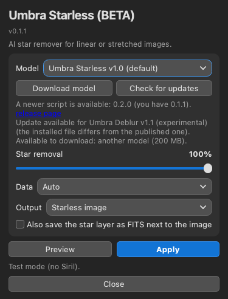
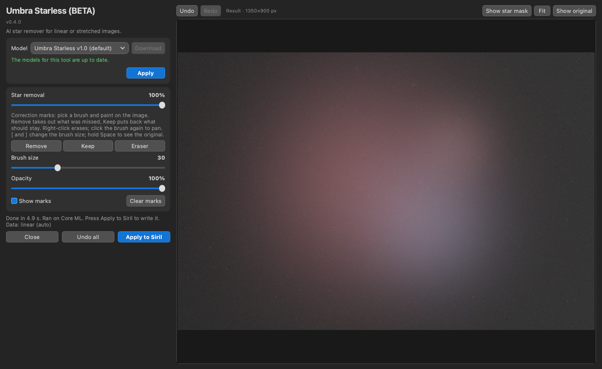
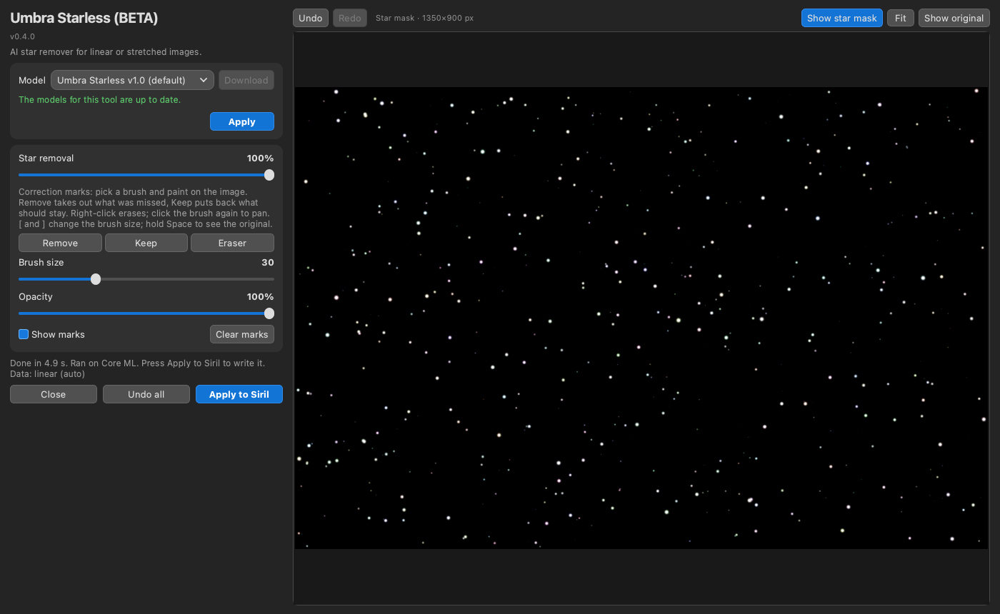

# Umbra Starless (BETA)

Umbra Starless is an AI star remover for [Siril](https://siril.org). It works on linear or stretched images. It is a Siril Python script with an AI model. It runs locally on your computer and is free. It removes stars and their halos and fills the holes, and it can give you the star layer on its own.

**Status: Beta (v0.3.0).** Expect rough edges.

*Screenshots (synthetic test image): the window before running, after Apply, and with Show star mask.*

## Download and install

1. Download the single file [`Umbra_Starless.py`](https://raw.githubusercontent.com/Kishanhpatel/umbra-starless/main/Umbra_Starless.py) (also attached to the [latest release](https://github.com/Kishanhpatel/umbra-starless/releases/latest)). Save it in any folder you like. Siril has no standard scripts folder name.
2. In Siril open **Preferences > Scripts**, add that folder, refresh the list, then run **Umbra Starless** from the Scripts menu.
3. First run: Siril installs the Python packages the script needs (numpy, onnxruntime, PyQt6, scipy, astropy). This can take a few minutes.
4. If no model is installed, the model drop-down lists it as "Umbra Starless v1.0 (Not Downloaded)". Select it and press **Download**, right of the drop-down (about 100 MB). The file is checked with SHA-256 and saved in a folder named `Umbra Starless` next to the script.

**Auto-keep model.** The small Auto-keep model (about 3 MB) is only used by the command-line `--auto-keep` option. The **Download** button does not offer it. Get it with `python Umbra_Starless.py --download umbra_starless_critic_v1.0` (or `--download all`) if you need it.

**Manual install.** Download the `.onnx` files from the [release page](https://github.com/Kishanhpatel/umbra-starless/releases/latest) and put them in the `Umbra Starless` folder next to the script. To use another folder, set `UMBRA_STARLESS_MODEL_DIR` to it. `UMBRA_STARLESS_MODEL` can point at one specific model file.

**Updates.** Each time the script opens, it checks the published list (`models/models.json`) for a newer script and for new or changed models. A line under the model row shows the result. In green: "The models for this tool are up to date." In yellow: "There is an update to this script available" or "There is a new model available for this tool, select the model in the dropdown and click Download to install." A model downloads only when you press **Download**. A newer script is shown as a link to the release page; the script never replaces itself. Nothing is sent about you or your computer (only a generic client name). With no network the installed models keep working. Set `UMBRA_STARLESS_OFFLINE=1` (or `UMBRA_OFFLINE=1`) to turn the lookup off.

## What it does

The model runs once over the whole image in 512 px tiles. Controls:

- **Star removal** (0 to 100%, default 100): 100 removes all stars. Lower values make every star smaller and dimmer; faint stars go first. 0 leaves the original image.
- **Show star mask** (in the image area): shows the star layer.

The star layer is always saved when you press **Apply to Siril**, as `starmask_<image file name>` next to the image (for example `starmask_M42.fits`). `_1`, `_2` is added instead of overwriting an existing file. **Apply to Siril** always writes the starless image to Siril. The script detects from the image whether it is linear or stretched. Star removal below 100% still keeps linear data linear: it reduces stars, it does not stretch the image. The star removal also cleans up the halos of big bright stars better than before (fewer glow rings and dark centres).

The star layer is the input minus the starless result for linear data, and recombines with it by screen blending for stretched data. Starless plus stars gives back the input (to float rounding).

**The window.** The window has a fixed-width controls column on the left and a large image area on the right. The image area shows the current image (auto-stretched) as soon as the window opens. Scroll or pinch to zoom and drag to pan. Double-click the image or press **Fit** to fit the whole image. Hold down **Show original**, or hold the Space key anywhere in the window, to compare with the image before the tool; release it to see the result again. **Undo** and **Redo** at the top left of the image area step back and forward through your Apply results (Cmd/Ctrl+Z and Cmd/Ctrl+Shift+Z); the last 10 steps are kept. The window keeps its size when you switch tools or models.

**Star removal and correction marks.** **Apply** sits right under the model list. The **Star removal** slider and the brushes are in a second panel below it, greyed out until **Apply** has made the star mask; then the slider brings stars back or removes them right away. Star removal starts at 100% each time. The star removal itself is computed once per image and model (the network is the slow part). After that, the marks and the **Star removal** slider update quickly. Moving **Star removal** updates the result from the stored result.

**Correction marks** are painted directly on the image in the main window. Click a brush to paint with it, and click it again to go back to pan and zoom. Right-click erases. The middle mouse button pans.
- **Remove**: paint where stars or residue were wrongly kept.
- **Keep**: paint where something was wrongly removed (a galaxy or nebula knot). The original comes back there.
- **Eraser**: erases marks.
- **Brush size** (1 to 100, default 30; keys **[** and **]** make it smaller and bigger).
- **Opacity** (5 to 100%): the strength of each stroke.
- **Show marks**: shows or hides the overlay.
- **Clear marks**: removes all marks.

After each stroke the result updates by itself. Marks are drawn on the picture as Siril shows it and are mapped to the image rows correctly, including Siril's flipped row order. Marks belong to the image that is open; if the image in Siril changed, they are not used.

**StarNet++.** If the StarNet2 command-line program is installed (found through Siril's StarNet setting or the usual install locations), the model list also shows "StarNet++ vX (installed)", and the script uses it for star removal. Marks, **Star removal** and **Show star mask** still work. If it is not installed, no StarNet entry appears. StarNet++ is not included or distributed with Umbra: install it yourself. Older StarNet++ versions that only take TIFF files on the command line are not supported.

**Apply and Apply to Siril.** **Apply** (the small blue button inside the tool's panel) runs the tool on the whole image and shows the result in the image area. The image in Siril is not changed. **Apply to Siril** writes the current result to the image in Siril as one step, so Siril's **Undo** goes back. If you changed the settings since **Apply**, it runs the tool first. Until then the image in Siril is not changed, whatever you do in the window. **Undo all** (bottom row, between **Close** and **Apply to Siril**) goes back to the image as it was when the window opened, and also puts it back in Siril if you had written anything; **Redo** can still bring the steps back. Siril's scripting interface cannot write a FITS HISTORY line, so the settings used are written to the Siril log (and into any extra FITS file the tool saves).

**Command line.** `python Umbra_Starless.py --image IN.fits --out OUT.fits` runs the tool without a window. Flags: `--removal 0..1`, `--data auto|linear|stretched`, `--output starless|stars`, `--stars-out FILE`, `--auto-keep` (with `--critic-model PATH`, default: the installed one), `--remove-marks MAP.fits` and `--keep-marks MAP.fits` (maps from 0 to 1, same size as the image, rows as stored in the file), `--model PATH`. `--data`, `--output` and `--auto-keep` are no longer in the window. `--check-updates` and `--download [MODEL_ID|all]` work from the command line too, and `--help` lists everything.

## Models

Since v0.2.0 the model files store their weights at half size (16-bit) and compute in full 32-bit precision, so the results are bit-identical to the larger v0.1.x files. If you already have the larger file it keeps working and is not downloaded again.

Models are published as GitHub release assets and are not stored in this repository. See `models/models.json`.

| Name | File | Size | Notes |
|---|---|---|---|
| Umbra Starless v1.0 (default) | `umbra_starless_v1.0.onnx` | 100 MB | The main model. |
| Umbra Starless v1.1 (experimental) | `umbra_starless_v1.1_experimental.onnx` | 100 MB | A small gain over v1.0 in our tests. Judge by eye on your image. |
| Umbra Starless Auto-keep model v1.0 | `umbra_starless_critic_v1.0.onnx` | 3 MB | Only used by the command-line `--auto-keep` option. Not a star remover; it is not listed in the model menu and the **Download** button does not offer it. |

## Strengths

- Removes stars and halos on both linear and stretched images, and the star layer is available as its own output.
- The Star removal slider reduces stars gradually instead of all or nothing, and updates quickly in the image area.
- Correction brushes (Remove and Keep) for the places the model gets wrong, painted directly on the image.
- Starless plus star layer gives back the input image.
- Fills the holes from the surroundings. Noise in the filled areas matches the rest of the image.
- Handles mono images and images with NaN holes (stacking borders); NaN pixels stay NaN.
- GPU acceleration with automatic CPU fallback.

## Weaknesses

- Very bright stars (for example Alnitak, or the stars in NGC 2264 and the Wizard Nebula) can leave glows or starburst artefacts.
- Bright nebula and galaxy cores can be partly taken for stars. The core of the Orion Nebula (M42) is still partly cut and leaves a messy patch.
- Compact knots in galaxies (M82, spiral-arm knots in M33) and thin filaments (Veil, Crescent) can partly go into the star layer.
- The command-line `--auto-keep` option is conservative: on many images it puts back little or nothing, and it can miss structure. It is not in the window; use the Keep brush instead.
- Remove marks are a hint to the network, not a guarantee: a mark may need a second stroke or a smaller or larger brush.
- Images smaller than 512 px on a side are processed differently from the original near the bottom edge (see Testing).
- Big frames are heavy: a 6016 x 6016 colour frame took about 70 s on an Apple M3 (Core ML) and about 7.5 GB of memory. Marks and the star layer keep extra copies of the image, so very large frames need more.
- Tested mainly on the author's own data and one Mac.

## GPU acceleration

The GPU is used by default whenever one can be used, and the CPU only as a fallback. Providers are tried in this order: CUDA (NVIDIA), DirectML (Windows), ROCm and MIGraphX (AMD on Linux), OpenVINO (Intel), Core ML (Mac), then CPU. Each one is checked against the CPU result on a small probe tile before it is used; if it fails or the result differs, the script falls back to the CPU. The status line says which one ran ("Ran on ..."). Set `UMBRA_STARLESS_CPU=1` to force the CPU.

On first run the script installs the onnxruntime package that gives your system a GPU:

- **Mac:** `onnxruntime` (Core ML, Apple GPU, built in).
- **Windows:** `onnxruntime-directml` (any DirectX 12 GPU: NVIDIA, AMD or Intel; no extra downloads).
- **Linux with an NVIDIA GPU:** `onnxruntime-gpu` (CUDA). If the system has no CUDA 12 / cuDNN 9 libraries, NVIDIA's own pip packages of them are installed too (a one-time download of about 2 to 3 GB).
- **Linux with AMD or Intel graphics:** there is no GPU build that installs automatically, so these run on the CPU. If you install `onnxruntime-rocm`, `onnxruntime-migraphx` or `onnxruntime-openvino` yourself in Siril's Python, the script uses it.

## Testing

Be aware of what has and has not been tried. This is a beta.

Tested:
- macOS 26 on an Apple M3, with Core ML and with the CPU.
- Standalone (command line and window test) and inside Siril 1.4.5 run headless (`siril-cli` with `pyscript`): read the image, process it, write it back with an Undo state, save.
- The window was tested offscreen only. The brushes in the main window were tested offscreen with synthetic mouse strokes.
- v0.4.0: the shared history (Apply, Undo, Redo, Apply to Siril, Undo all), the brushes (including Clone) and the Space / [ ] keys were tested offscreen with a stand-in for Siril and synthetic mouse drags, not yet in the Siril window itself.

NOT tested:
- Windows and Linux.
- CUDA, DirectML and ROCm (the code is written; please report what you see).
- Intel Macs.
- The interactive window inside the Siril GUI, and painting with a real mouse or pen.
- Very large frames with marks (memory use is several times the image size).
- StarNet++ inside the Siril window (it was tested from the command line with StarNet2 v2.6.2 on macOS: star removal, star layer and exact recombination; images smaller than 512 px are padded for StarNet and cropped back).

Correction marks and Auto-keep were compared with the original PyTorch version on three 1024 px crops with synthetic marks: Remove and Keep marks, Auto-keep and their combination differ by at most about 2 noise sigma at a single pixel (the same threshold outlier as without marks) and by about 0.02 sigma rms or less; the Auto-keep map differs by 2e-7. The Auto-keep model flagged only 0.05 to 0.2 percent of those crops. Remove marks use a local noise fill like the original script.

Parity with the original PyTorch version: the whole pipeline (default settings, three removal amounts, star layer) differs by at most about 0.3 noise sigma at a single pixel (3 sigma at one pixel of one image at partial removal) and about 1e-4 sigma rms, against changes of tens to hundreds of sigma. Cases: five real crops (up to 2048 px), mono, a NaN hole, stretched data. Core ML and CPU agree.
Small images: the model uses fixed 512 px tiles, so images under 512 px are padded by mirroring. A 300 x 400 crop differed near the padded bottom edge (rms 5 sigma overall, 0.2 to 0.7 sigma in the interior, against a change of 47 sigma). This cannot be matched with a fixed 512 px model. Recombining starless and stars is still exact.

## Layout

- `Umbra_Starless.py`: the script (v0.3.0, ONNX Runtime, with model download and update check)
- `models/models.json`: model manifest (name, version, download URL, SHA-256, size)
- `docs/screenshots/`: window screenshots
- `LICENSE`, `LICENSE-MODELS.md`: licenses

## Contact

Bugs or questions: umbraastrolabs@gmail.com, or open an issue on GitHub.

## License

- Script: GPL-3.0-only (see `LICENSE`).
- Models: CC BY-NC-SA 4.0, non-commercial (see `LICENSE-MODELS.md`).
